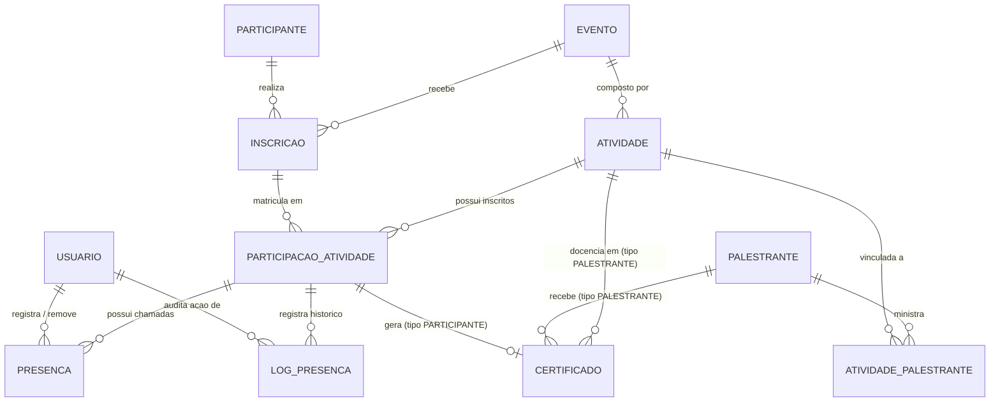

# Sistema de Gestão de Eventos Acadêmicos - BICT/UFMA

Sistema web completo para gerenciamento, controle de frequência multidias e certificação de eventos acadêmicos, desenvolvido com **Python (FastAPI)**, **Raw SQL puro (aiomysql)**, **MariaDB/MySQL** (`mariadb:lts`) e orquestrado via **Docker Compose**, em conformidade rigorosa com o modelo relacional em 3ª Forma Normal (3FN) da disciplina de Banco de Dados.

---

## 👥 Integrantes e Informações Acadêmicas (Página `/sobre`)

> **Trabalho acadêmico da Universidade Federal do Maranhão do curso BICT, disciplina Banco de Dados. Participantes: Francisco Erik da Silva, Joao Elivaldo Barros Moraes, Jose Diomar Machado Costa. Professor da disciplina: CLAUDIO MANOEL PEREIRA AROUCHA.**

Acesse a página institucional em: `http://localhost:8000/sobre`

---

## 🛠️ Stack Tecnológica e Decisões de Arquitetura

* **Backend:** Python 3.11 com [FastAPI](https://fastapi.tiangolo.com/) (assíncrono, alta performance).
* **Banco de Dados:** [MariaDB LTS](https://mariadb.org/) (compatível com MySQL 8.0/8.4, rodando em contêiner otimizado).
* **Acesso ao Banco (Zero ORM):** Utilização estrita de **Raw SQL puro** com driver assíncrono [`aiomysql`](https://github.com/aio-libs/aiomysql) gerenciado via pool de conexões (`database.py`). Todas as consultas utilizam parâmetros seguros (`%s`) contra SQL Injection.
* **Frontend:** Templates server-side com [Jinja2](https://palletsprojects.com/p/jinja/), estilizados com [Bootstrap 5](https://getbootstrap.com/) e ícones Bootstrap Icons via CDN.
* **Autenticação:** Baseada em sessões seguras com tokens JWT criptografados armazenados em cookies HTTP-Only, com senhas em hash SHA-256 e controle de acesso por perfil (`ADMIN`, `APOIO`, `PARTICIPANTE`, `PALESTRANTE`).
* **DevOps & Infraestrutura:** Orquestração completa em contêineres via [Docker Compose](https://docs.docker.com/compose/).

---

## 📁 Estrutura de Diretórios do Projeto

```text
projeto-banco-p3/
├── auth.py                  # Autenticação JWT, hashing SHA-256 e RBAC
├── database.py              # Pool de conexões assíncronas aiomysql (Raw SQL)
├── main.py                  # Ponto de entrada FastAPI e registro de rotas
├── requirements.txt         # Dependências Python (sem ORMs)
├── Dockerfile               # Imagem da aplicação FastAPI Web
├── docker-compose.yml       # Orquestração do MariaDB LTS e Web FastAPI
├── init.sql                 # DDL de criação do schema 3FN e dados iniciais (seeds)
├── .env.example           # Modelo de variáveis de ambiente do projeto
├── .gitignore               # Configuração detalhada de arquivos ignorados pelo Git
├── README.md                # Documentação técnica e dicionário de dados
├── routers/                 # Divisão modular de rotas da aplicação
│   ├── auth_routes.py         # Login, logout e cadastro unificado
│   ├── public_routes.py       # Home, sobre, verificação pública de certificados
│   ├── staff_routes.py        # Painel admin, CRUDs, presenças e relatórios
│   ├── participante_routes.py # Inscrições e histórico do participante
│   └── palestrante_routes.py  # Atividades e certificados do docente
└── templates/               # Interfaces Jinja2 com Bootstrap 5
    ├── base.html              # Layout base com navbar responsiva
    ├── index.html             # Página inicial do portal
    ├── login.html             # Formulário de login por perfil
    ├── cadastro.html          # Cadastro de novos participantes
    ├── sobre.html             # Página acadêmica obrigatória
    ├── verificar_certificado.html # Validação pública e visualização A4
    ├── admin/                 # Telas exclusivas da comissão organizadora / staff
    │   ├── dashboard.html       # Painel de controle e atalhos rápidos
    │   ├── eventos.html         # CRUD completo de eventos
    │   ├── atividades.html      # CRUD de atividades e critérios de certificação
    │   ├── presencas.html       # Chamada multidias, pesquisa e auditoria
    │   ├── participantes.html   # Gestão de participantes inscritos
    │   ├── palestrantes.html    # Gestão de palestrantes e vínculos
    │   ├── certificados.html    # Gestão e revogação de certificados
    │   ├── staff.html           # Gestão de membros da equipe de apoio
    │   └── relatorios.html      # Estatísticas e métricas de frequência
    ├── participante/          # Telas exclusivas do discente
    │   └── painel.html          # Inscrições, presenças e certificados do discente
    └── palestrante/           # Telas exclusivas do docente / palestrante
        └── painel.html          # Grade de palestras e emissão de certificados
```

---

## 🏛️ Relações entre as Tabelas (Modelo Relacional / DER)

O banco de dados foi estruturado rigorosamente na **3ª Forma Normal (3FN)**, composto por **11 tabelas relacionais** (10 tabelas de negócio e relacionamento + 1 tabela de auditoria e conformidade).

### Diagrama Entidade-Relacionamento (Mermaid)



### Diagrama ASCII Simplificado

```
                  +-------------------+
                  |      usuario      | (Equipe de Apoio / Staff)
                  +-------------------+
                   | (registra)     | (audita)
                   v                v
+--------------+    +-------------------+    +--------------------+
| participante |<---|     inscricao     |<---|       evento       |
+--------------+    +-------------------+    +--------------------+
                            |                           |
                            v                           v
                    +-------------------+    +--------------------+    +-----------------------+
                    | participacao_ativ |<---|     atividade      |<---| atividade_palestrante |
                    +-------------------+    +--------------------+    +-----------------------+
                      |         |     |                 ^                          ^
                      |         |     v                 |                          |
                      |         |   +---------------+   |                 +-------------+
                      |         |   | log_presenca  |   |                 | palestrante |
                      |         |   +---------------+   |                 +-------------+
                      v         v                       |                        |
                +------------+  +-------------+---------+                        |
                |  presenca  |  | certificado |----------------------------------+
                +------------+  +-------------+
```

### Detalhamento das Tabelas e Cardinalidades

1. **`usuario` (Staff / Apoio):**
   * Armazena os membros da equipe organizadora e monitores com senhas criptografadas em SHA-256 e perfis (`APOIO`, `ADMIN`).
   * **Relacionamento:** `usuario (1) -> (N) presenca`: cada registro de chamada é assinado pelo membro do staff que a gerou (`id_usuario`) ou removeu (`id_usuario_remocao`).
   * **Relacionamento:** `usuario (1) -> (N) log_presenca`: rastreia todas as alterações efetuadas pelo usuário.

2. **`participante`:**
   * Cadastro dos discentes e ouvintes (`id_participante`, `cpf`, `nome`, `email`, `telefone`, `senha_hash`).
   * Possui restrições `UNIQUE(cpf)` e `UNIQUE(email)`.
   * **Relacionamento:** `participante (1) -> (N) inscricao`.

3. **`evento`:**
   * Eventos acadêmicos principais (`id_evento`, `codigo`, `nome`, `descricao`, `data_inicio`, `data_fim`, `local`, `status`).
   * `codigo` possui restrição `UNIQUE` (ex: `EVT-BICT-2026`).
   * **Relacionamentos:**
     * `evento (1) -> (N) atividade`: um evento agrega múltiplas atividades.
     * `evento (1) -> (N) inscricao`: participantes se inscrevem no evento.

4. **`atividade`:**
   * Sessões do evento (`id_atividade`, `id_evento`, `tipo`, `nome`, `data_atividade`, `data_fim`, `hora_inicio`, `hora_fim`, `carga_horaria`, `limite_vagas`, `frequencia_minima`, `exige_conclusao`).
   * O intervalo de realização é delimitado por `data_atividade` (início) e `data_fim` (término).
   * **Relacionamentos:**
     * `evento (1) -> (N) atividade` via `id_evento`.
     * `atividade (1) -> (N) participacao_atividade`.
     * `atividade (N) <-> (N) palestrante` mediado por `atividade_palestrante`.

5. **`palestrante` & `atividade_palestrante`:**
   * `palestrante`: Cadastro de docentes, palestrantes e convidados com mini biografia e titulações.
   * `atividade_palestrante`: Tabela associativa com chave primária composta `PRIMARY KEY (id_atividade, id_palestrante)` resolvendo a relação N:N.

6. **`inscricao`:**
   * Representa a matrícula geral do participante no evento acadêmico.
   * **Garantia de Unicidade:** Restrição `UNIQUE (id_participante, id_evento)`, impedindo que o mesmo aluno se inscreva duas vezes no mesmo evento.

7. **`participacao_atividade`:**
   * Vincula a inscrição do participante a uma atividade específica do evento.
   * **Garantia de Unicidade:** Restrição `UNIQUE (id_inscricao, id_atividade)`, impedindo duplicidade na mesma atividade.

8. **`presenca` (Multidias com Validação de Intervalo):**
   * Controla o registro de frequência por sessão/dia.
   * **Chave Única Composta:** `UNIQUE (id_participacao, data_aula)`, permitindo chamada em múltiplos dias para a mesma atividade sem duplicidade na mesma data.
   * **Regra de Negócio:** A `data_aula` é estritamente validada para ocorrer **apenas entre `data_atividade` e `data_fim`** da atividade.
   * **Auditoria Integrada:** Identifica `id_usuario` (quem gerou) e `id_usuario_remocao` (quem removeu).

9. **`log_presenca` (Auditoria Histórica Imutável):**
   * Registra cronologicamente cada concessão (`GERADA`) ou revogação (`REMOVIDA`) de presença, com carimbo de data/hora e referência ao membro do staff.

10. **`certificado` (Polimórfico para Participante e Palestrante):**
    * Emissão oficial de certificação digital (`id_certificado`, `tipo_destinatario`, `id_participacao`, `id_palestrante`, `id_atividade`, `codigo_validacao`, `status`, `data_emissao`, `carga_horaria`).
    * **Se Participante:** `tipo_destinatario = 'PARTICIPANTE'`, preenche `id_participacao` (com `UNIQUE(id_participacao)`).
    * **Se Palestrante:** `tipo_destinatario = 'PALESTRANTE'`, preenche `id_palestrante` e `id_atividade` (com `UNIQUE(id_palestrante, id_atividade)`).

---

## 📚 Dicionário de Dados do Banco de Dados (`eventos_db`)

Abaixo está o catálogo completo de metadados das **11 tabelas** do sistema, especificando colunas, tipos de dados físicos, domínios, restrições de nulidade, chaves (`PK`, `FK`, `UK`) e descrições semânticas.

### 1. Tabela `usuario`
> **Propósito:** Armazena os usuários da equipe organizadora e monitores de apoio acadêmico que realizam chamadas e administram eventos.

| Coluna | Tipo / Domínio | Chave | Nulo? | Descrição |
| :--- | :--- | :---: | :---: | :--- |
| **`id_usuario`** | `INT AUTO_INCREMENT` | **PK** | NÃO | Identificador numérico sequencial e exclusivo do membro do staff. |
| **`cpf`** | `CHAR(11)` (11 dígitos numéricos) | **UK** | NÃO | CPF do usuário, sem pontuação. Chave de unicidade (`UNIQUE`). |
| **`nome`** | `VARCHAR(150)` | - | NÃO | Nome completo do membro da equipe de apoio/admin. |
| **`email`** | `VARCHAR(150)` (formato e-mail válido) | **UK** | NÃO | E-mail de autenticação no sistema. Chave de unicidade (`UNIQUE`). |
| **`senha_hash`** | `VARCHAR(255)` (hash hex SHA-256 de 64 caracteres) | - | NÃO | Hash criptográfico da senha de acesso do usuário. |
| **`perfil`** | `VARCHAR(50)` (Ex: `'APOIO'`, `'ADMIN'`) | - | SIM | Nível de acesso administrativo. Default: `'APOIO'`. |
| **`status`** | `ENUM('ATIVO', 'INATIVO')` | - | SIM | Situação cadastral do usuário. Default: `'ATIVO'`. |
| **`data_cadastro`** | `DATETIME` | - | SIM | Data e horário de criação do registro. Default: `CURRENT_TIMESTAMP`. |

---

### 2. Tabela `participante`
> **Propósito:** Cadastro de participantes (discentes, pesquisadores e público externo) inscritos nos eventos acadêmicos.

| Coluna | Tipo / Domínio | Chave | Nulo? | Descrição |
| :--- | :--- | :---: | :---: | :--- |
| **`id_participante`** | `INT AUTO_INCREMENT` | **PK** | NÃO | Identificador numérico sequencial e exclusivo do participante. |
| **`cpf`** | `CHAR(11)` (11 dígitos numéricos) | **UK** | NÃO | CPF do participante. Chave de unicidade (`UNIQUE`). |
| **`nome`** | `VARCHAR(150)` | - | NÃO | Nome completo do participante. |
| **`email`** | `VARCHAR(150)` (formato e-mail) | **UK** | NÃO | E-mail do participante utilizado para login e notificações. `UNIQUE`. |
| **`senha_hash`** | `VARCHAR(255)` (hash hex SHA-256) | - | NÃO | Hash da senha de acesso à Área do Participante. |
| **`telefone`** | `VARCHAR(20)` | - | SIM | Telefone / WhatsApp para contato. |

---

### 3. Tabela `palestrante`
> **Propósito:** Cadastro de palestrantes, ministrantes de minicursos e instrutores de workshops.

| Coluna | Tipo / Domínio | Chave | Nulo? | Descrição |
| :--- | :--- | :---: | :---: | :--- |
| **`id_palestrante`** | `INT AUTO_INCREMENT` | **PK** | NÃO | Identificador numérico sequencial e exclusivo do palestrante. |
| **`cpf`** | `CHAR(11)` (11 dígitos numéricos) | **UK** | NÃO | CPF do palestrante. Chave de unicidade (`UNIQUE`). |
| **`nome`** | `VARCHAR(150)` | - | NÃO | Nome completo do palestrante/docente. |
| **`email`** | `VARCHAR(150)` (formato e-mail) | **UK** | NÃO | E-mail do palestrante para login no portal. `UNIQUE`. |
| **`senha_hash`** | `VARCHAR(255)` (hash hex SHA-256) | - | NÃO | Hash da senha de acesso à Área do Palestrante. |
| **`telefone`** | `VARCHAR(20)` | - | SIM | Telefone comercial ou pessoal de contato. |
| **`curriculo`** | `TEXT` | - | SIM | Mini biografia, titulação acadêmica e histórico profissional. |

---

### 4. Tabela `evento`
> **Propósito:** Registra os eventos acadêmicos principais (congressos, semanas de curso, simpósios, jornadas).

| Coluna | Tipo / Domínio | Chave | Nulo? | Descrição |
| :--- | :--- | :---: | :---: | :--- |
| **`id_evento`** | `INT AUTO_INCREMENT` | **PK** | NÃO | Identificador numérico sequencial e exclusivo do evento. |
| **`codigo`** | `VARCHAR(50)` (Ex: `'EVT-BICT-2026'`) | **UK** | SIM | Código identificador público e único do evento. `UNIQUE`. |
| **`nome`** | `VARCHAR(180)` | - | NÃO | Nome completo do evento acadêmico. |
| **`descricao`** | `TEXT` | - | SIM | Ementa, justificativa e detalhes sobre o evento. |
| **`data_inicio`** | `DATE` | - | SIM | Data de início de realização do evento (`AAAA-MM-DD`). |
| **`data_fim`** | `DATE` | - | SIM | Data de encerramento do evento (`AAAA-MM-DD`). |
| **`local`** | `VARCHAR(180)` | - | SIM | Local físico (auditório, campus) ou link de transmissão virtual. |
| **`status`** | `ENUM('ATIVO', 'CANCELADO', 'FINALIZADO')` | - | SIM | Situação do evento. Default: `'ATIVO'`. |

---

### 5. Tabela `atividade`
> **Propósito:** Armazena as atividades específicas vinculadas a um evento (palestras, minicursos, mesas-redondas, oficinas), seus horários e requisitos para certificação.

| Coluna | Tipo / Domínio | Chave | Nulo? | Descrição |
| :--- | :--- | :---: | :---: | :--- |
| **`id_atividade`** | `INT AUTO_INCREMENT` | **PK** | NÃO | Identificador numérico sequencial e exclusivo da atividade. |
| **`id_evento`** | `INT` | **FK** | NÃO | Referência ao evento organizador (`evento.id_evento`). |
| **`tipo`** | `VARCHAR(80)` (Ex: `'Minicurso'`, `'Palestra'`) | - | SIM | Classificação da atividade acadêmica. |
| **`nome`** | `VARCHAR(180)` | - | NÃO | Título da atividade/palestra. |
| **`descricao`** | `TEXT` | - | SIM | Descrição detalhada do conteúdo programático. |
| **`data_atividade`** | `DATE` | - | SIM | Data inicial de realização da atividade (`AAAA-MM-DD`). |
| **`data_fim`** | `DATE` | - | SIM | Data final de término da atividade para controle multidias. |
| **`hora_inicio`** | `TIME` | - | SIM | Horário de início da sessão (`HH:MM:SS`). |
| **`hora_fim`** | `TIME` | - | SIM | Horário de término da sessão (`HH:MM:SS`). |
| **`carga_horaria`** | `DECIMAL(5,2)` ($> 0$, Ex: `8.00`) | - | SIM | Carga horária total a constar no certificado do participante/docente. |
| **`limite_vagas`** | `INT` ($> 0$) | - | SIM | Capacidade máxima de participantes para a atividade. |
| **`frequencia_minima`** | `DECIMAL(5,2)` ($0.00$ a $100.00$) | - | SIM | Percentual mínimo de presença exigido para certificação. Default: `75.00`. |
| **`exige_conclusao`** | `TINYINT(1)` (`0` = Não, `1` = Sim) | - | SIM | Indica se exige entrega de projeto/avaliação. Default: `0`. |
| **`status`** | `VARCHAR(50)` (Ex: `'AGENDADA'`, `'ENCERRADA'`) | - | SIM | Situação operacional da atividade. Default: `'AGENDADA'`. |

---

### 6. Tabela `atividade_palestrante`
> **Propósito:** Tabela associativa que resolve o relacionamento muitos-para-muitos (N:N) entre atividades e palestrantes/ministrantes.

| Coluna | Tipo / Domínio | Chave | Nulo? | Descrição |
| :--- | :--- | :---: | :---: | :--- |
| **`id_atividade`** | `INT` | **PK, FK** | NÃO | Referência à atividade ministrada (`atividade.id_atividade`). |
| **`id_palestrante`** | `INT` | **PK, FK** | NÃO | Referência ao palestrante responsável (`palestrante.id_palestrante`). |

* **Chave Primária Composta:** `PRIMARY KEY (id_atividade, id_palestrante)`.

---

### 7. Tabela `inscricao`
> **Propósito:** Registra a inscrição/matrícula geral de um participante em um determinado evento acadêmico.

| Coluna | Tipo / Domínio | Chave | Nulo? | Descrição |
| :--- | :--- | :---: | :---: | :--- |
| **`id_inscricao`** | `INT AUTO_INCREMENT` | **PK** | NÃO | Identificador numérico sequencial e exclusivo da inscrição. |
| **`id_participante`** | `INT` | **FK, UK** | NÃO | Referência ao participante inscrito (`participante.id_participante`). |
| **`id_evento`** | `INT` | **FK, UK** | NÃO | Referência ao evento escolhido (`evento.id_evento`). |
| **`numero`** | `VARCHAR(50)` (Ex: `'INS-2026-001'`) | **UK** | SIM | Código/número localizador exclusivo da inscrição. `UNIQUE`. |
| **`data_inscricao`** | `DATETIME` | - | SIM | Data e horário em que a inscrição foi realizada. Default: `CURRENT_TIMESTAMP`. |
| **`status`** | `VARCHAR(50)` (Ex: `'CONFIRMADA'`) | - | SIM | Status da inscrição no evento. Default: `'CONFIRMADA'`. |

* **Chave de Unicidade Composta:** `UNIQUE (id_participante, id_evento)`, impedindo duplicação de inscrição do mesmo aluno no mesmo evento.

---

### 8. Tabela `participacao_atividade`
> **Propósito:** Registra a vinculação da inscrição do participante a uma atividade específica do evento.

| Coluna | Tipo / Domínio | Chave | Nulo? | Descrição |
| :--- | :--- | :---: | :---: | :--- |
| **`id_participacao`** | `INT AUTO_INCREMENT` | **PK** | NÃO | Identificador numérico sequencial da matrícula na atividade. |
| **`id_inscricao`** | `INT` | **FK, UK** | NÃO | Referência à inscrição geral no evento (`inscricao.id_inscricao`). |
| **`id_atividade`** | `INT` | **FK, UK** | NÃO | Referência à atividade matriculada (`atividade.id_atividade`). |
| **`data_inscricao`** | `DATETIME` | - | SIM | Data e horário da matrícula na atividade. Default: `CURRENT_TIMESTAMP`. |
| **`status`** | `VARCHAR(50)` (Ex: `'CONFIRMADA'`) | - | SIM | Situação da matrícula na atividade. Default: `'CONFIRMADA'`. |

* **Chave de Unicidade Composta:** `UNIQUE (id_inscricao, id_atividade)`, impedindo que o aluno se matricule duas vezes na mesma atividade.

---

### 9. Tabela `presenca`
> **Propósito:** Registra as chamadas/frequências multidias dos alunos matriculados nas atividades, com restrição de intervalo e auditoria de quem gerou e quem removeu a presença.

| Coluna | Tipo / Domínio | Chave | Nulo? | Descrição |
| :--- | :--- | :---: | :---: | :--- |
| **`id_presenca`** | `INT AUTO_INCREMENT` | **PK** | NÃO | Identificador numérico sequencial do registro de presença. |
| **`id_participacao`** | `INT` | **FK, UK** | NÃO | Referência à matrícula do aluno (`participacao_atividade.id_participacao`). |
| **`id_usuario`** | `INT` | **FK** | NÃO | Referência ao membro do Staff que **gerou/confirmou** a presença (`usuario.id_usuario`). |
| **`id_usuario_remocao`** | `INT` | **FK** | SIM | Referência ao membro do Staff que **removeu/desmarcou** a presença (`usuario.id_usuario`). |
| **`data_aula`** | `DATE` | **UK** | NÃO | Data em que a aula/sessão ocorreu (`AAAA-MM-DD`). Validada para o intervalo da atividade. |
| **`presente`** | `TINYINT(1)` (`0` = Ausente, `1` = Presente) | - | SIM | Indicador booleano de presença física/virtual. Default: `0`. |
| **`data_registro`** | `DATETIME` | - | SIM | Data e horário exato em que a presença foi gerada no banco. |
| **`data_remocao`** | `DATETIME` | - | SIM | Data e horário exato em que a presença foi removida/desmarcada. |

* **Chave de Unicidade Composta:** `UNIQUE (id_participacao, data_aula)`, garantindo que cada participante só tenha um registro por dia de aula da atividade.

---

### 10. Tabela `log_presenca`
> **Propósito:** Histórico de auditoria de todas as ações de concessão e revogação de presenças executadas pela equipe de apoio.

| Coluna | Tipo / Domínio | Chave | Nulo? | Descrição |
| :--- | :--- | :---: | :---: | :--- |
| **`id_log`** | `INT AUTO_INCREMENT` | **PK** | NÃO | Identificador numérico sequencial do evento de auditoria. |
| **`id_participacao`** | `INT` | **FK** | NÃO | Referência à matrícula do participante (`participacao_atividade.id_participacao`). |
| **`id_usuario`** | `INT` | **FK** | NÃO | Referência ao membro do Staff que executou a ação (`usuario.id_usuario`). |
| **`acao`** | `ENUM('GERADA', 'REMOVIDA')` | - | NÃO | Ação executada pelo staff: `'GERADA'` (marcou presente) ou `'REMOVIDA'` (marcou ausente). |
| **`data_aula`** | `DATE` | - | NÃO | Data da aula relacionada ao evento de presença. |
| **`data_hora`** | `DATETIME` | - | SIM | Data e horário exato do log de auditoria. Default: `CURRENT_TIMESTAMP`. |

---

### 11. Tabela `certificado`
> **Propósito:** Armazena os certificados acadêmicos digitais gerados, suportando de forma unificada Participantes e Palestrantes.

| Coluna | Tipo / Domínio | Chave | Nulo? | Descrição |
| :--- | :--- | :---: | :---: | :--- |
| **`id_certificado`** | `INT AUTO_INCREMENT` | **PK** | NÃO | Identificador numérico sequencial exclusivo do certificado. |
| **`tipo_destinatario`**| `ENUM('PARTICIPANTE', 'PALESTRANTE')` | - | NÃO | Indica o papel do titular do certificado. Default: `'PARTICIPANTE'`. |
| **`id_participacao`** | `INT` | **FK, UK** | SIM | Referência à matrícula do participante (preenchido se `PARTICIPANTE`). |
| **`id_palestrante`** | `INT` | **FK, UK** | SIM | Referência ao palestrante ministrante (preenchido se `PALESTRANTE`). |
| **`id_atividade`** | `INT` | **FK, UK** | SIM | Referência à atividade ministrada (preenchido se `PALESTRANTE`). |
| **`codigo_validacao`** | `VARCHAR(80)` (Ex: `'CERT-UFMA-2026-BICT01'`) | **UK** | NÃO | Código criptográfico alfanumérico para verificação pública. `UNIQUE`. |
| **`status`** | `ENUM('VALIDO', 'REVOGADO')` | - | SIM | Estado de autenticidade jurídica do documento. Default: `'VALIDO'`. |
| **`data_emissao`** | `DATETIME` | - | SIM | Data e horário de emissão do certificado. Default: `CURRENT_TIMESTAMP`. |
| **`carga_horaria`** | `DECIMAL(5,2)` | - | NÃO | Carga horária total atestada no documento. |

* **Chaves de Unicidade:**
  * `UNIQUE (id_participacao)`: Garante que um participante tenha apenas 1 certificado por atividade cursada.
  * `UNIQUE (id_palestrante, id_atividade)`: Garante que um palestrante receba apenas 1 certificado docente por atividade ministrada.
  * `UNIQUE (codigo_validacao)`: Garante que cada certificado tenha um código único no ecossistema.

---

## 🔍 Como Funciona o Validador de Certificado (`/verificar`)

A funcionalidade de **Verificação Pública de Autenticidade** permite que qualquer entidade, empresa ou instituição de ensino valide a legitimidade de um certificado acadêmico emitido pelo sistema.

### 1. Fluxo de Validação Passo a Passo

```
 [ Usuário insere o Código ] 
              │
              ▼
   [ Busca SQL no Banco ] (via aiomysql com múltiplos LEFT JOINs)
              │
      ┌───────┴───────────────────────────────────┐
      │                                           │
[ Encontrado? ]                             [ NÃO Encontrado ]
      │                                           │
      ├──────────────────────┐                    ▼
      ▼                      ▼              Exibe Alerta Vermelho:
[ Status: VALIDO ]    [ Status: REVOGADO ]  "Certificado Inválido ou
      │                      │               Não Encontrado"
      ▼                      ▼
Exibe Certificado     Exibe Alerta Laranja:
Oficial com Dados     "Certificado foi REVOGADO
Formatados e Fé       pela Comissão Organizadora"
Pública
```

### 2. A Consulta SQL Pura (Raw SQL)

A verificação executa uma única consulta otimizada utilizando `LEFT JOIN`s para resolver unificadamente o destinatário, seja ele um **Participante** (que cursou a atividade) ou um **Palestrante** (que ministrou a atividade):

```sql
SELECT 
    c.id_certificado,
    c.tipo_destinatario,
    c.codigo_validacao,
    c.status,
    c.data_emissao,
    c.carga_horaria,
    -- Identificação unificada do titular
    COALESCE(p.nome, pal.nome) AS participante_nome,
    COALESCE(p.cpf, pal.cpf) AS participante_cpf,
    COALESCE(p.email, pal.email) AS participante_email,
    -- Identificação da atividade e evento
    COALESCE(a.nome, a_pal.nome) AS atividade_nome,
    COALESCE(a.tipo, a_pal.tipo) AS atividade_tipo,
    COALESCE(e.nome, e_pal.nome) AS evento_nome,
    COALESCE(e.local, e_pal.local) AS evento_local,
    COALESCE(e.data_inicio, e_pal.data_inicio) AS data_inicio,
    COALESCE(e.data_fim, e_pal.data_fim) AS data_fim
FROM certificado c
-- Ramo do Participante:
LEFT JOIN participacao_atividade pa ON c.id_participacao = pa.id_participacao
LEFT JOIN inscricao i ON pa.id_inscricao = i.id_inscricao
LEFT JOIN participante p ON i.id_participante = p.id_participante
LEFT JOIN atividade a ON pa.id_atividade = a.id_atividade
LEFT JOIN evento e ON a.id_evento = e.id_evento
-- Ramo do Palestrante:
LEFT JOIN palestrante pal ON c.id_palestrante = pal.id_palestrante
LEFT JOIN atividade a_pal ON c.id_atividade = a_pal.id_atividade
LEFT JOIN evento e_pal ON a_pal.id_evento = e_pal.id_evento
WHERE UPPER(c.codigo_validacao) = %s;
```

### 3. Diferenciação Visual e Textual do Documento

* **Certificado de Participante:**
  O documento destaca que o aluno *"participou com êxito da atividade acadêmica [Nome da Atividade] no evento [Nome do Evento], cumprindo a carga horária de [X] horas"*.
* **Certificado de Palestrante:**
  O documento destaca que o docente *"atuou com excelência como **PALESTRANTE / MINISTRANTE** da atividade acadêmica [Nome da Atividade] no evento [Nome do Evento], totalizando a carga horária docente de [X] horas"*.
* **Impressão:** A página possui folha de estilos `@media print` otimizada, permitindo a impressão em formato A4 como diploma oficial.

---

## 🔎 Pesquisa de Presenças por Participante e Auditoria de Staff

O sistema possui controle completo e auditável de frequência acadêmica acessível na rota **`/admin/presencas`**:

### 1. Pesquisa de Presenças por Participante
* **Como utilizar:** No painel de chamadas, o Staff insere o **Nome** (ou parte do nome) ou o **CPF** do aluno no campo *"Pesquisar Todas as Presenças de Determinado Participante"*.
* **Resultado Consolidado:** O sistema executa uma consulta SQL trazendo todas as aulas que o participante teve em todas as suas atividades e eventos cadastrados, exibindo:
  * Data da aula e título da atividade / evento.
  * Situação (`Presente` ou `Ausente / Removida`).
  * **Quem Gerou a Presença:** Nome do membro do Staff e data/hora do lançamento.
  * **Quem Removeu a Presença:** Nome do membro do Staff e data/hora da remoção (quando desmarcada).

### 2. Identificação de Quem Gerou ou Removeu a Presença
* A tabela `presenca` armazena de forma auditável:
  * `id_usuario`: chave estrangeira que identifica quem **gerou** a presença (`presente = 1`).
  * `id_usuario_remocao`: chave estrangeira que identifica quem **removeu** a presença (`presente = 0`).
  * `data_registro` e `data_remocao`: timestamps das respectivas operações.
* **Tabela `log_presenca`:** Toda alteração gera adicionalmente um registro histórico imutável (`GERADA` ou `REMOVIDA`), com data/hora e o ID do staff responsável, visível na tabela de logs de auditoria em tempo real na tela do Staff.
* **Extrato do Aluno:** O próprio participante também visualiza seu histórico completo detalhado em sua área restrita (`/participante/painel`), com transparência sobre as ações registradas pelo Staff.

---

## 🔒 Credenciais de Acesso Pré-Configuradas

| Perfil | E-mail | Senha | Destino Pós-Login |
| :--- | :--- | :--- | :--- |
| **Staff (Apoio)** | `staff@eventos.ufma.br` | `senha123` | Painel Administrativo (`/admin/dashboard`) |
| **Staff (Admin)** | `admin@eventos.ufma.br` | `senha123` | Painel Administrativo (`/admin/dashboard`) |
| **Participante** | `erik@discente.ufma.br` | `senha123` | Área do Participante (`/participante/painel`) |
| **Palestrante** | `palestrante@eventos.ufma.br` | `senha123` | Área do Palestrante (`/palestrante/painel`) |

---

## 🧪 Códigos de Teste Pré-Cadastrados para Verificação Pública

* **Certificado Válido de Participante:** `CERT-UFMA-2026-BICT01`
* **Certificado Válido de Palestrante:** `CERT-UFMA-2026-PALESTRA01`
* **Certificado Inexistente (Teste de Erro):** `CERT-INEXISTENTE`

---

## 🚀 Como Executar com Docker Compose

Suba todo o ambiente (Banco de Dados MariaDB LTS + FastAPI Web):

```bash
docker compose up -d --build
```

Acesse no navegador:
👉 **`http://localhost:8000`**

Para visualizar os logs dos contêineres em tempo real:
```bash
docker compose logs -f
```

Para reiniciar o serviço da aplicação sem recriar o banco:
```bash
docker compose restart web
```

---

## 🗺️ Mapa de Rotas e Endpoints da Aplicação

Todas as operações são executadas via **SQL puro** (Raw SQL assíncrono via `aiomysql`), com controle de permissão por perfil de acesso e proteção de sessão com cookies HTTP-Only.

### 1. Rotas Públicas e Institucionais
| Método | Endpoint | Descrição |
| :---: | :--- | :--- |
| `GET` | `/` | Página inicial com apresentação do sistema e eventos acadêmicos. |
| `GET` | `/sobre` | **Página institucional obrigatória** com identificação formal dos discentes e docente. |
| `GET` | `/login` | Tela de autenticação com seletor de perfil (Staff, Participante, Palestrante). |
| `POST` | `/login` | Processamento do login, verificação de hash SHA-256 e emissão do cookie JWT. |
| `GET` | `/cadastro` | Formulário público de cadastro para discentes/ouvintes. |
| `POST` | `/cadastro` | Cadastro de participante com validação de unicidade de CPF e e-mail via Raw SQL. |
| `GET` | `/logout` | Destruição da sessão/cookie e redirecionamento seguro para a home. |
| `GET` | `/verificar` | Validador público de certificados com renderização A4 para impressão. |
| `GET` | `/api/verificar/{codigo}` | Endpoint REST público retornando metadados de validação em JSON. |

### 2. Rotas do Painel Administrativo / Staff (`/admin/*`)
| Método | Endpoint | Perfil | Descrição |
| :---: | :--- | :---: | :--- |
| `GET` | `/admin/dashboard` | `APOIO`, `ADMIN` | Visão geral com contadores rápidos de eventos, participantes e certificados. |
| `GET` | `/admin/eventos` | `APOIO`, `ADMIN` | Listagem e formulário de cadastro/edição de eventos acadêmicos. |
| `POST` | `/admin/eventos/salvar` | `APOIO`, `ADMIN` | Gravação ou atualização de evento via SQL puro. |
| `POST` | `/admin/eventos/cancelar/{id}` | `ADMIN` | Cancelamento formal de evento acadêmico. |
| `GET` | `/admin/atividades` | `APOIO`, `ADMIN` | Gestão de atividades, datas de início/fim e requisitos de certificado. |
| `POST` | `/admin/atividades/salvar` | `APOIO`, `ADMIN` | Criação/edição de atividade com validação de datas e carga horária. |
| `POST` | `/admin/atividades/cancelar/{id}` | `ADMIN` | Cancelamento de atividade. |
| `GET` | `/admin/presencas` | `APOIO`, `ADMIN` | Painel de chamada multidias, auditoria de staff e histórico. |
| `POST` | `/admin/presencas/registrar` | `APOIO`, `ADMIN` | Registro/desmarcação de presença com validação de intervalo e log. |
| `GET` | `/admin/presencas/pesquisar` | `APOIO`, `ADMIN` | Busca detalhada de todas as presenças de um aluno por Nome ou CPF. |
| `GET` | `/admin/participantes` | `APOIO`, `ADMIN` | Gestão de participantes cadastrados no sistema. |
| `POST` | `/admin/participantes/salvar` | `APOIO`, `ADMIN` | Criação ou atualização cadastral de participantes. |
| `GET` | `/admin/palestrantes` | `APOIO`, `ADMIN` | Gestão de docentes/palestrantes e vínculos de ministração. |
| `POST` | `/admin/palestrantes/salvar` | `APOIO`, `ADMIN` | Cadastro/edição de palestrantes e currículo. |
| `GET` | `/admin/certificados` | `APOIO`, `ADMIN` | Gestão de certificados de participantes e palestrantes. |
| `POST` | `/admin/certificados/status` | `ADMIN` | Alteração de status do certificado (`VALIDO` / `REVOGADO`). |
| `GET` | `/admin/staff` | `ADMIN` | Gestão da equipe de apoio e criação de novos usuários administradores. |
| `POST` | `/admin/staff/salvar` | `ADMIN` | Criação e atualização de membros da equipe de apoio. |
| `GET` | `/admin/relatorios` | `APOIO`, `ADMIN` | Painel estatístico consolidado com taxas de ocupação e frequência. |

### 3. Rotas da Área do Participante (`/participante/*`)
| Método | Endpoint | Perfil | Descrição |
| :---: | :--- | :---: | :--- |
| `GET` | `/participante/painel` | `PARTICIPANTE` | Painel do aluno com inscrições, frequência detalhada e certificados. |
| `POST` | `/participante/inscrever-evento` | `PARTICIPANTE` | Inscrição no evento acadêmico (bloqueia duplicidade via `UNIQUE`). |
| `POST` | `/participante/inscrever-atividade` | `PARTICIPANTE` | Matrícula em minicursos, palestras e oficinas do evento. |

### 4. Rotas da Área do Palestrante (`/palestrante/*`)
| Método | Endpoint | Perfil | Descrição |
| :---: | :--- | :---: | :--- |
| `GET` | `/palestrante/painel` | `PALESTRANTE` | Grade de atividades ministradas e visualização de certificados docentes. |

---

## 🛡️ Conformidade Rigorosa com a 3FN e Integridade de Dados

O projeto atende a todas as exigências formais de normalização e modelagem relacional da disciplina de Banco de Dados:

1. **Primeira Forma Normal (1FN):**
   * Todos os atributos possuem domínios atômicos e indivisíveis.
   * Não existem colunas repetitivas ou estruturas multivaloradas.
   * Todas as tabelas possuem chave primária explícita (`PRIMARY KEY`).

2. **Segunda Forma Normal (2FN):**
   * Todas as colunas não-chave dependem funcionalmente da totalidade da chave primária.
   * Nas tabelas associativas com chave primária composta (`atividade_palestrante`), os atributos dependem da chave inteira `(id_atividade, id_palestrante)`.

3. **Terceira Forma Normal (3FN):**
   * Nenhum atributo não-chave depende transitivamente de outro atributo não-chave.
   * Dados do evento (nome, local, datas) pertencem à tabela `evento` e não são replicados em `atividade` nem em `inscricao`.
   * Informações de auditoria do staff residem em `usuario` e são referenciadas via chaves estrangeiras (`id_usuario`, `id_usuario_remocao`).

4. **Tratamento de Exceções de Integridade sem ORM:**
   * Violações de chaves de unicidade (como inscrição duplicada no mesmo evento) disparam `aiomysql.IntegrityError` (código de erro MySQL `1062 - Duplicate entry`), o qual é interceptado assincronamente pelo FastAPI, retornando alertas claros e amigáveis ao usuário via interface Bootstrap.


